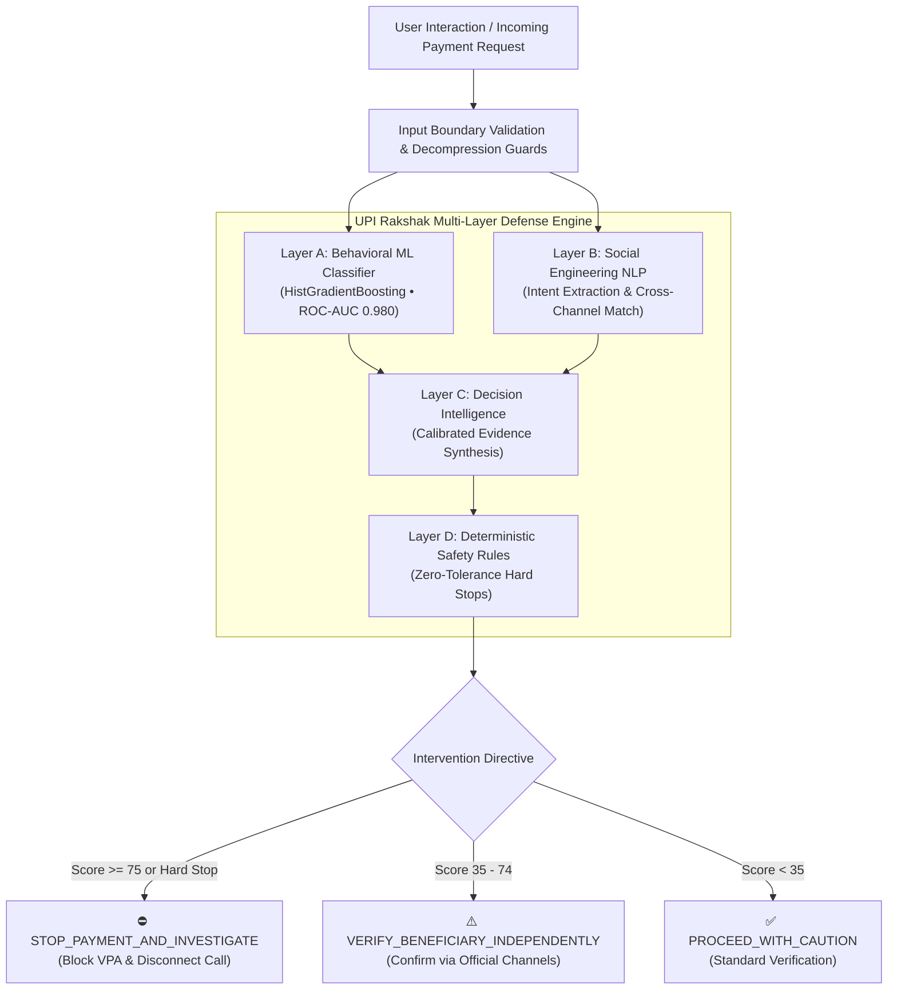

# 🛡️ UPI Rakshak — Sovereign Pre-Transaction Risk Intelligence

> **Zero-Trust Pre-Payment Fraud Prevention & Social Engineering Interceptor for India's Digital Payment Ecosystem.**

[](LICENSE)
[](https://fastapi.tiangolo.com)
[](https://react.dev)
[](https://tailwindcss.com)
[]()
[]()

---

## 📌 Executive Overview

UPI executes in milliseconds with cryptographically signed push payments. Once authorized with a UPI PIN, fund recovery through chargebacks is virtually impossible (national recovery rate < 8%). 

Modern cybercriminals do not hack banking cryptography; they exploit human psychology through **Digital Arrest**, **Inverted Refund Traps**, **Screen-Sharing Takeover**, and **Live Phone Call Coercion**.

**UPI Rakshak** operates strictly **pre-transaction** — intercepting high-risk behavioral velocity, deceptive conversational intent, and active social engineering signals **before** the victim confirms payment or enters their PIN.

---

## 🚀 Key Capabilities

- **⚡ Dual-Engine Risk Evaluation**: Combines a trained **HistGradientBoosting ML Classifier** (trained on 100,000 synthesized payment vectors with 0.980 ROC-AUC) with **Deterministic Sovereign Safety Guardrails**.
- **📞 Active Call Coercion Detection**: Real-time detection of simultaneous voice/video calls during checkout. Alerts users in Hindi and English (*"धोखेबाज कॉल पर रखकर दबाव बनाते हैं..."*) and commands immediate call disconnection.
- **⚡ Rapid Multi-Payment Velocity Warning**: Alerts victims when instructed to split large sums into consecutive micro-transfers to bypass bank alerts.
- **💬 Progressive Conversational Intent Scanner**: Evaluates multi-turn WhatsApp, SMS, or Telegram chat logs for psychological pressure, authority cloaking (CBI, Police, RBI), and urgency countdowns.
- **📸 Screenshot OCR Security Scanner**: Extracts transaction parameters from banking screenshots with decompression bomb defenses (max 10 MP) and format validation.
- **🧠 SHAP Feature Attribution**: Explains every prediction with local risk-increasing and protective feature drivers for complete auditability.
- **⚖️ Decision Intelligence**: Structured evidence-driven synthesis with graceful local fallback if external gateways are offline.
- **🖨️ Audit & Law Enforcement Export**: Ready-to-file incident dossiers formatted for immediate submission to the National Cyber Crime Reporting Portal (**Helpline 1930**).

---

## 📚 Technical Documentation Suite

Comprehensive engineering and deployment documentation is available in the [`docs/`](docs/) directory:

| Document | Focus & Scope |
|---|---|
| [**Architecture & System Design**](docs/ARCHITECTURE.md) | Technical architecture, 4-layer engine breakdown, SHAP integration, and OWASP ASVS threat modeling. |
| [**API Reference & Integration Guide**](docs/API_REFERENCE.md) | Complete REST API specification, schemas, error codes, and curl examples for all endpoints. |
| [**Mobile & Smartphone Integration Guide**](docs/MOBILE_APP_GUIDE.md) | PWA installation, Capacitor Android APK packaging, and native Android Call Overlay Guardian architecture. |
| [**Threat Typology & Incident Playbook**](docs/THREAT_MODEL_AND_TYPOLOGY.md) | In-depth breakdown of the 10 UPI scam vectors, social engineering mechanics, and Golden Hour emergency protocols. |
| [**Production Deployment & Operations Guide**](docs/DEPLOYMENT_GUIDE.md) | Docker, Docker Compose, Nginx reverse proxy with TLS hardening, rate limiting, and ASGI production tuning. |

---

## 🏗️ 4-Layer Defense Architecture



---

## 🛠️ Quick Start Guide

### Prerequisites
- **Python**: `>= 3.10` (tested on 3.10, 3.12, 3.14)
- **Node.js**: `>= 18.0` (tested on 20, 22, 24)

### One-Click Launch (Windows)
Double-click `start_dev.bat` or run:
```powershell
.\start_dev.ps1
```

### Manual Setup

#### 1. Backend Service
```bash
# From project root
pip install -r requirements.txt
python -m uvicorn backend.app.main:app --reload --host 127.0.0.1 --port 8000
```
Backend API will be live at `http://127.0.0.1:8000`  
Interactive Swagger docs: `http://127.0.0.1:8000/docs`

#### 2. Frontend Application
```bash
cd frontend
npm install
npm run dev
```
Open **`http://localhost:5173`** in your browser.

---

## 📡 Core API Endpoints

| Method | Endpoint | Description |
|---|---|---|
| `POST` | `/api/assess/unified` | **Primary Gateway**: Evaluates payment parameters, flags, and dialogue context together. |
| `POST` | `/api/assess/payment` | Legacy standalone payment risk assessment. |
| `POST` | `/api/ml/predict` | Direct ML inference with SHAP feature factor weights. |
| `POST` | `/api/assess/conversation` | NLP semantic scan of conversation scripts or SMS texts. |
| `POST` | `/api/conversation/progressive` | Multi-turn streaming chat scanner. |
| `POST` | `/api/scan/screenshot` | OCR multipart image upload for transaction parameter extraction. |
| `GET` | `/api/ml/status` | Heartbeat & provenance info of the loaded scikit-learn model. |
| `GET` | `/api/analytics` | Statistical risk distribution and aggregate telemetry. |

---

## 🔒 Security Posture & Standards Compliance

UPI Rakshak is engineered following **OWASP Application Security Verification Standard (ASVS)** and **OWASP API Security Top 10 (2023)**:

1. **Zero-Knowledge Privacy**: No credentials, passwords, or UPI PINs are ever requested, processed, or logged.
2. **Bounded In-Memory Storage (CWE-400)**: Audit stores and report registries are hard-capped at 500 items with FIFO rotation to prevent memory exhaustion DoS.
3. **Strict CORS Policy (CWE-942)**: Restricted to explicit localhost/production origins; wildcard (`*`) access is disabled.
4. **Input Boundary Enforcement (CWE-20)**: All Pydantic request models enforce maximum string lengths, value ranges, and regex sanity checks.
5. **Image Decompression Bomb Defense (CWE-770)**: Image uploads are checked for dimension limits (`Image.MAX_IMAGE_PIXELS = 10_000_000`) and format verification before processing.
6. **Security Headers (CWE-693)**: Outgoing responses enforce `X-Content-Type-Options: nosniff`, `X-Frame-Options: DENY`, and strict referrer policies.

---

## 🧪 Verification & Test Suites

Run the automated integration tests from the root directory:

```bash
# Context correlation & decision engine tests (16 tests)
python test_context_and_jev.py

# OCR image processing & decompression bomb tests (11 tests)
python test_ocr_integration.py

# Machine Learning prediction & SHAP explainability tests
python test_ml_integration.py
```

---

## 📄 License

This project is licensed under the MIT License — see the [LICENSE](LICENSE) file for details.

