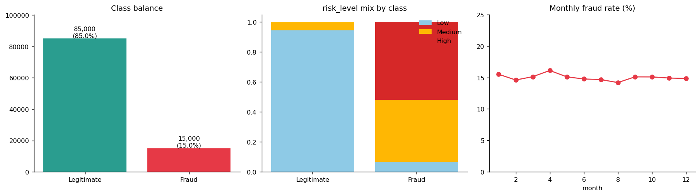
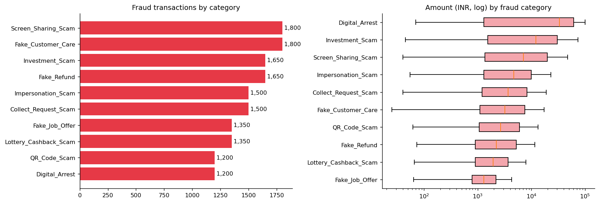
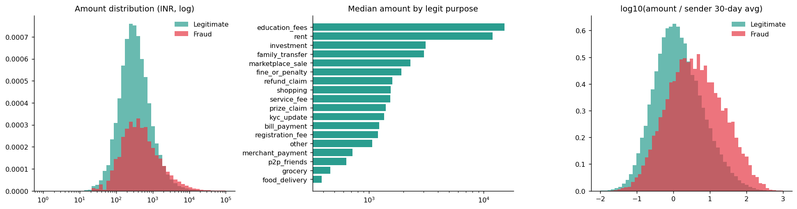
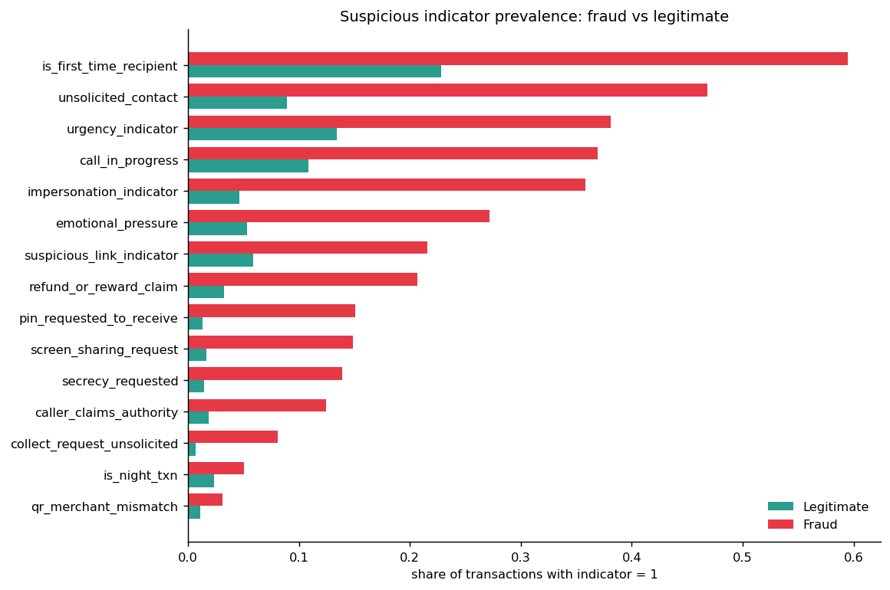
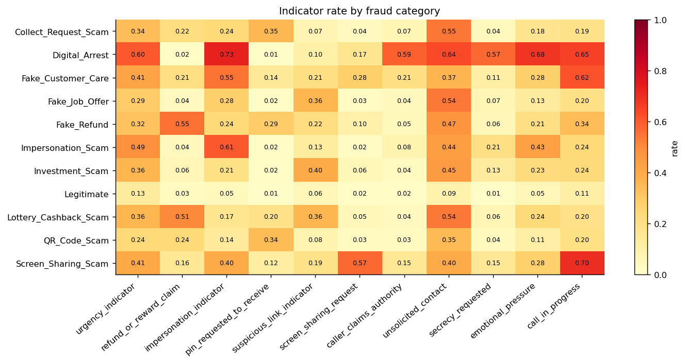
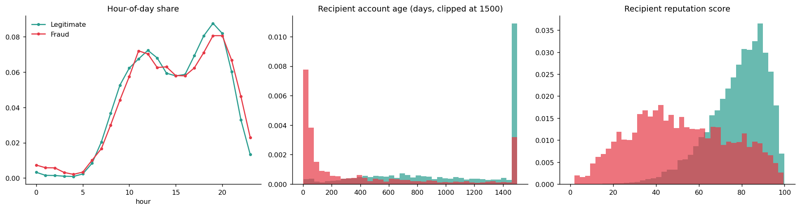
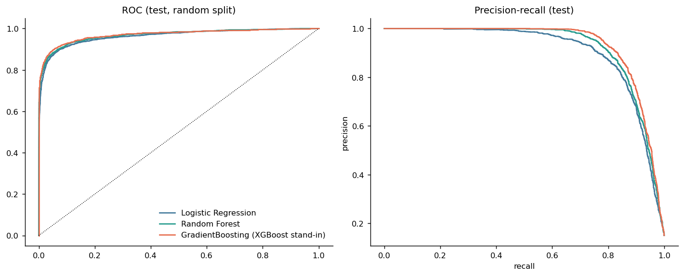

# UPI Rakshak - Synthetic Dataset Analysis Report

**All data in this dataset is fully synthetic** (generated with NumPy/Pandas, seed 42). No real UPI IDs, people, banks or transactions were used.

## 1. Overview
| Item | Value |
|---|---|
| Rows / columns | 100,000 / 45 |
| Legitimate / fraud | 85,000 (85.0%) / 15,000 (15.0%) |
| Period | 2025-01-01 to 2025-12-31 |
| Unique senders / recipients | 26,982 / 29,161 |
| Targets | `is_fraud` (binary), `fraud_category` (11 classes), `risk_level` (Low/Medium/High) |
| Model features | 38 (32 numeric/binary, 6 categorical) |

Legitimate purposes: grocery, merchant payment, family transfer, shopping, bill payment, food delivery, friends, rent, education fees, investment, marketplace sale, other.
Fraud scenarios (10): fake refund, fake customer care, QR code, collect request, fake job offer, investment, lottery/cashback, impersonation, digital arrest, screen sharing.

## 2. Fraud distribution

| fraud_category | fraud_rows | median_amount | mean_amount | pct_first_time | mean_se_score | pct_high_risk |
|---|---|---|---|---|---|---|
| Screen_Sharing_Scam | 1800 | 7,044.86 | 14,771.12 | 0.61 | 0.33 | 0.63 |
| Fake_Customer_Care | 1800 | 3,200.00 | 6,292.55 | 0.63 | 0.34 | 0.57 |
| Investment_Scam | 1650 | 12,033.50 | 20,037.39 | 0.43 | 0.23 | 0.40 |
| Fake_Refund | 1650 | 2,229.50 | 4,298.23 | 0.64 | 0.23 | 0.53 |
| Impersonation_Scam | 1500 | 4,692.57 | 8,003.43 | 0.56 | 0.34 | 0.52 |
| Collect_Request_Scam | 1500 | 3,668.50 | 6,580.41 | 0.64 | 0.22 | 0.52 |
| Lottery_Cashback_Scam | 1350 | 1,943.39 | 3,182.32 | 0.63 | 0.22 | 0.52 |
| Fake_Job_Offer | 1350 | 1,300.00 | 2,031.95 | 0.50 | 0.21 | 0.33 |
| Digital_Arrest | 1200 | 33,484.76 | 34,785.27 | 0.67 | 0.63 | 0.73 |
| QR_Code_Scam | 1200 | 2,663.00 | 4,912.60 | 0.67 | 0.15 | 0.42 |

## 3. Transaction amounts
| index | median_amount | mean_amount | p95_amount | recipient_age_median | reputation_mean | first_time | night | se_score |
|---|---|---|---|---|---|---|---|---|
| Legitimate | 1,000.00 | 3,234.29 | 13,681.20 | 1,184.00 | 78.18 | 0.23 | 0.02 | 0.07 |
| Fraud | 3,117.93 | 10,308.05 | 51,209.91 | 124.00 | 51.53 | 0.59 | 0.05 | 0.29 |

Amounts are lognormal per scenario, capped at Rs 1,00,000 (typical UPI limit). Digital arrest and investment scams skew large, but fake refund, lottery and QR scams overlap strongly with everyday amounts.

## 4. Suspicious indicators
| index | legit | fraud | lift |
|---|---|---|---|
| is_first_time_recipient | 0.228 | 0.595 | 2.606 |
| unsolicited_contact | 0.090 | 0.468 | 5.231 |
| urgency_indicator | 0.134 | 0.381 | 2.837 |
| call_in_progress | 0.108 | 0.369 | 3.405 |
| impersonation_indicator | 0.046 | 0.358 | 7.760 |
| emotional_pressure | 0.053 | 0.272 | 5.127 |
| suspicious_link_indicator | 0.059 | 0.215 | 3.645 |
| refund_or_reward_claim | 0.032 | 0.207 | 6.424 |
| pin_requested_to_receive | 0.013 | 0.151 | 11.543 |
| screen_sharing_request | 0.017 | 0.149 | 8.808 |
| secrecy_requested | 0.014 | 0.139 | 9.792 |
| caller_claims_authority | 0.019 | 0.125 | 6.657 |
| collect_request_unsolicited | 0.007 | 0.081 | 12.079 |
| is_night_txn | 0.024 | 0.050 | 2.133 |
| qr_merchant_mismatch | 0.011 | 0.031 | 2.861 |

## 5. Realism: class overlap (by design)
Each row mixes a legitimate profile with a scam profile through a hidden weight (not saved). About 20% of fraud rows are "stealth" (look mostly normal) and about 17% of legitimate rows borrow some scam-like traits (urgent bills, new landlords, genuine support calls).

| index | share |
|---|---|
| fraud rows with <=1 of 11 core flags | 27.4% |
| fraud rows with no flag at all | 9.3% |
| legit rows with >=1 core flag | 40.2% |
| legit rows with >=2 core flags | 12.4% |
| legit first-time recipients | 22.8% |
| legit recipients < 90 days old | 3.1% |
| fraud recipients with reputation >= 60 | 36.3% |
| fraud recipients with account age >= 365 d | 36.3% |

`risk_level` vs class (row-normalised):

| is_fraud | Low | Medium | High |
|---|---|---|---|
| Fraud | 0.067 | 0.414 | 0.519 |
| Legitimate | 0.945 | 0.054 | 0.002 |

## 6. Leakage checks
- PASS: 100,000 rows
- PASS: fraud rate exactly 15%
- PASS: no missing values
- PASS: unique transaction_id
- PASS: first-time flag consistent with prior count
- PASS: QR flag consistent with channel
- PASS: collect flag consistent with channel
- PASS: 7d count >= 24h count
- PASS: amount in [1, 100000]
- PASS: legit rows labelled 'Legitimate'
- PASS: no feature with |corr| > 0.9 to target
- PASS: no single feature with AUC > 0.9
- PASS: no ID shared across train/test rows (transaction_id)
- PASS: stratified splits keep 15% fraud

Top single-feature AUCs (no single feature solves the task):

| index | single_feature_auc |
|---|---|
| recipient_reputation_score | 0.826 |
| social_engineering_risk_score | 0.823 |
| recipient_account_age_days | 0.816 |
| recipient_prior_complaints | 0.743 |
| prior_txns_with_recipient | 0.728 |
| amount_inr | 0.694 |
| unsolicited_contact | 0.689 |
| is_first_time_recipient | 0.683 |

Rules to avoid leakage when modelling:
- Exclude `transaction_id`, `transaction_timestamp`, `sender_id`, `recipient_id` (mule recipient IDs repeat across rows).
- Exclude `fraud_category` and `risk_level` from `is_fraud` models; both are derived from the outcome. `risk_level` is an analyst-style triage label, not a pre-transaction input.
- The hidden mixing weights used for generation are not stored.
- Fit scalers/encoders on `train` only. Pick thresholds on `val`; report once on `test`.

## 7. Splits
| index | rows | fraud | fraud_rate |
|---|---|---|---|
| train | 70000 | 10500 | 0.1500 |
| val | 15000 | 2250 | 0.1500 |
| test | 15000 | 2250 | 0.1500 |
| temporal_train | 70000 | 10503 | 0.1500 |
| temporal_val | 15000 | 2272 | 0.1515 |
| temporal_test | 15000 | 2225 | 0.1483 |

`splits/train|val|test.csv`: stratified random 70/15/15 on is_fraud x fraud_category. `splits/temporal_*.csv`: first 70% / next 15% / last 15% by time, a harder and more deployment-like check.

## 8. Baseline sanity check (not tuned)
Quick default-ish models to show the dataset is learnable but not trivial. Threshold chosen on validation to maximise F1. sklearn HistGradientBoosting used as a stand-in because xgboost was not installable in this sandbox.

| split | model | test_roc_auc | test_pr_auc | threshold | test_precision | test_recall | test_f1 |
|---|---|---|---|---|---|---|---|
| random_stratified | Logistic Regression | 0.963 | 0.906 | 0.770 | 0.862 | 0.810 | 0.835 |
| random_stratified | Random Forest | 0.968 | 0.921 | 0.500 | 0.894 | 0.808 | 0.849 |
| random_stratified | GradientBoosting (XGBoost stand-in) | 0.972 | 0.931 | 0.780 | 0.915 | 0.819 | 0.864 |
| temporal | Logistic Regression | 0.960 | 0.901 | 0.770 | 0.859 | 0.804 | 0.831 |
| temporal | Random Forest | 0.965 | 0.915 | 0.490 | 0.890 | 0.801 | 0.843 |
| temporal | GradientBoosting (XGBoost stand-in) | 0.969 | 0.925 | 0.710 | 0.880 | 0.830 | 0.854 |

## 9. Limitations
- Synthetic: relationships come from the generator's assumptions, so absolute scores will not transfer to real UPI data. Use it for pipeline, model-comparison and methodology work.
- Sender/recipient velocity features are simulated per row, not computed from a full transaction graph.
- Fraud prevalence of 15% is far above real-world rates (well below 1%); for realism, evaluate with precision-recall metrics and consider down-sampling fraud for a low-prevalence test.
- Random splits share sender/recipient entities across sets (IDs are excluded from features).
