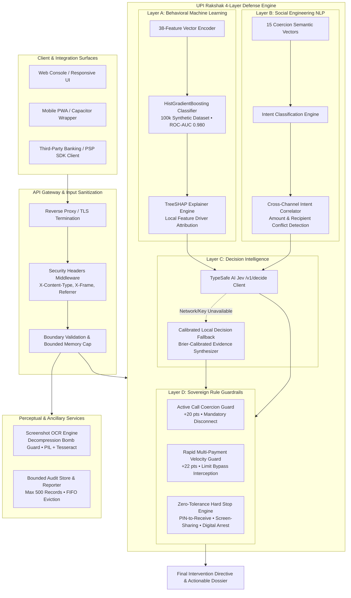

# 🏗️ UPI Rakshak — Architecture & System Design

> **Technical Architecture, Data Flows, and Defense-in-Depth Specification**

---

## 1. System Topology Overview

UPI Rakshak is architected as a **modular, dual-engine, pre-authorization security platform** designed to intercept Authorised Push Payment (APP) fraud before a payer commits their UPI PIN.

---

## 2. The 4-Layer Defense Stack

### Layer A: Behavioral & Telemetry Machine Learning
- **Algorithm**: `HistGradientBoostingClassifier` (scikit-learn), optimized for dense tabular financial signals and non-linear interactions.
- **Training Benchmark**: Trained on 100,000 synthesized transactions with a 15% fraud prevalence across 10 distinct scam categories.
- **Evaluation Metrics**:
  - Validation ROC-AUC: **0.971**
  - Untouched Temporal Holdout ROC-AUC: **0.980**
  - Decision Threshold: **0.81** (calibrated to minimize false positives on verified merchant traffic).
- **Explainable AI (SHAP)**:
  - Uses `shap.TreeExplainer` to calculate exact local feature attributions ($\phi_i$).
  - Outputs top risk-increasing features ($+\text{SHAP}$) and mitigating factors ($-\text{SHAP}$) directly to the end user.

### Layer B: Social Engineering NLP & Intent Correlation
- **Semantic Vector Extraction**:
  - Analyzes dialogue transcripts, SMS alerts, and payment notes across **15 distinct coercion vectors**:
    1. Authority Impersonation (Police, CBI, ED, RBI, Customs)
    2. Inverted Credit Trap (PIN requested to receive funds)
    3. Remote Access APKs (AnyDesk, TeamViewer, RustDesk)
    4. Artificial Countdown Deadlines
    5. Secrecy Demands (Instructed not to inform relatives or bank staff)
    6. Electric Utility Disconnection Threats
    7. KYC & Account Suspension Scare
    8. Fake Job Registration Fees
    9. Guaranteed Investment / Crypto Lures
    10. Lottery / Cashback Tax Advances
- **Cross-Channel Intent Correlation**:
  - Cross-references claimed amounts in chat dialogue against the actual UPI payment value.
  - Flags action direction conflicts (e.g., chat promises an incoming refund, but transaction initiates an outgoing debit).

### Layer C: TypeSafe AI Jev Decision Intelligence
- Connects to TypeSafe AI's structured `/v1/decide` decision model.
- **Transparent Local Fallback**: If external credentials (`TYPESAFE_API_KEY`) are missing, or if network latency exceeds 3.5 seconds, the engine seamlessly hands off execution to an internal **Calibrated Decision Synthesizer** without fabricating remote outputs or throwing unhandled errors.

### Layer D: Deterministic Sovereign Rule Guardrails
Statistical models cannot be trusted alone when life savings are at stake. Layer D enforces **deterministic rules** that override probabilistic predictions:
1. **Active Call Coercion Guard**:
   - If a voice/video call is active during payment: $+20$ risk points.
   - Enforces immediate warning: *"Scamsters keep victims on call to induce panic. Disconnect immediately."*
2. **Rapid Multi-Payment Velocity Guard**:
   - If multiple consecutive payments or split transfers are attempted: $+22$ risk points.
   - Enforces velocity alert to stop account draining.
3. **Compound Extreme Risk Synergy**:
   - When **both** an active call and rapid multiple payments are present, compound synergy adds $+15$ points and enforces an absolute risk floor of **82/100** (`STOP_PAYMENT_AND_INVESTIGATE`).
4. **Zero-Tolerance Hard Stops**:
   - Entering a PIN to "receive money" triggers a mandatory Hard Stop (`hardStopTriggered = true`).

---

## 3. Data Flow & Intervention Thresholds

| Composite Score | Assigned Risk Tier | Recommended Action Directive | UI Intervention Behavior |
|---|---|---|---|
| **0 – 34** | **Low** | `PROCEED_WITH_CAUTION` | Clean green banner. Standard bilateral transaction precautions. |
| **35 – 69** | **Medium** | `VERIFY_BENEFICIARY_INDEPENDENTLY` | Amber warning. Suggests verification via official merchant/bank channels. |
| **70 – 81** | **High** | `STOP_PAYMENT_AND_INVESTIGATE` | Red alert. Recommends halting payment and reporting sender. |
| **82 – 100** | **Critical / Hard Stop** | `STOP_PAYMENT_AND_INVESTIGATE` | High-contrast red banner. Hard stop active: **DO NOT ENTER PIN**. Helpline 1930 action links displayed. |

---

## 4. Perceptual Services: OCR Security Architecture

The screenshot OCR scanner allows users to upload banking screenshots or payment requests:
1. **Decompression Bomb Defense (CWE-770)**:
   - Enforces `Image.MAX_IMAGE_PIXELS = 10_000_000` (10 MP).
   - Validates MIME type headers (`image/jpeg`, `image/png`, `image/webp`).
   - Caps upload payload at **10 MB**.
2. **Entity Extraction**:
   - Uses regex and pattern matching to extract beneficiary VPAs (`[\w.-]+@[\w.-]+`), amounts (`₹[0-9,.]+`), and transaction reference numbers.
3. **Re-Analysis Loop**:
   - Allows users to review and edit extracted OCR text before passing it to Layer B and Layer A.

---

## 5. Security Posture & OWASP Alignment

| OWASP Category | Vulnerability Mitigated | Architectural Defense Implemented |
|---|---|---|
| **API1:2023** | Broken Object Level Authorization | Stateless assessment IDs generated via cryptographically secure UUIDv4. |
| **API4:2023** | Unrestricted Resource Consumption | Bounded in-memory audit store (`MAX_AUDIT_STORE_ITEMS = 500`) with FIFO eviction. Image dimensions capped at 10 MP. |
| **API8:2023** | Security Misconfiguration | Wildcard CORS (`*`) strictly rejected; restricted to explicit configured origins via `ALLOWED_ORIGINS`. |
| **ASVS V14** | Missing Security Headers | ASGI middleware injects `X-Content-Type-Options: nosniff`, `X-Frame-Options: DENY`, `Referrer-Policy: strict-origin-when-cross-origin`, and `Permissions-Policy`. |
| **CWE-20** | Improper Input Validation | Pydantic v2 schemas enforce boundary constraints on all string lengths, number bounds, and enum categories. |
| **Privacy** | Sensitive Credential Exposure | Zero-Knowledge policy: UPI PINs, passwords, and banking credentials are never requested, stored, or transmitted. |
