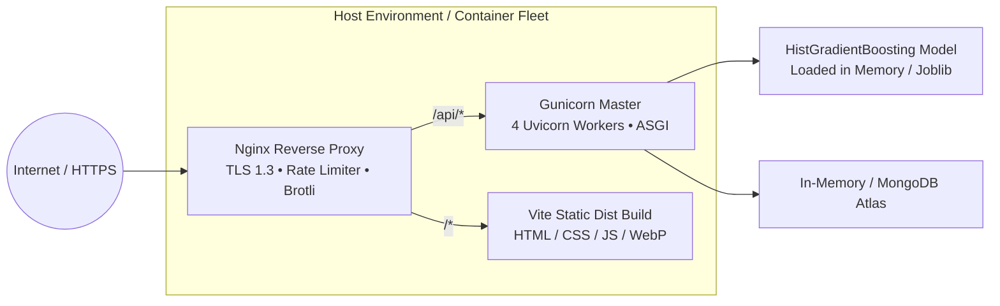

# 🚀 UPI Rakshak — Production Deployment & Operations Guide

> **Production Deployment, Dockerization, TLS Hardening, and Reverse Proxy Guide**

---

## 1. Production Architecture Overview

In production, UPI Rakshak operates behind an Nginx reverse proxy terminating TLS, with FastAPI managed by Gunicorn process managers and the frontend served as static assets:



---

## 2. Docker Deployment

### 2.1 Backend Dockerfile (`backend/Dockerfile`)
```dockerfile
FROM python:3.12-slim

WORKDIR /app

# Install system dependencies for Tesseract OCR
RUN apt-get update && apt-get install -y --no-install-recommends \
    tesseract-ocr \
    tesseract-ocr-hin \
    libgl1 \
    && rm -rf /var/lib/apt/lists/*

# Install Python dependencies
COPY requirements.txt .
RUN pip install --no-cache-dir -r requirements.txt

# Copy application source code
COPY backend ./backend

EXPOSE 8000

# Run with Gunicorn + Uvicorn worker for production concurrency
CMD ["gunicorn", "backend.app.main:app", "-w", "4", "-k", "uvicorn.workers.UvicornWorker", "--bind", "0.0.0.0:8000"]
```

### 2.2 Frontend Dockerfile (`frontend/Dockerfile`)
```dockerfile
# Multi-stage build
FROM node:20-alpine AS builder

WORKDIR /app
COPY frontend/package*.json ./
RUN npm ci

COPY frontend/ ./
RUN npm run build

# Stage 2: Serve with Nginx
FROM nginx:alpine
COPY --from=builder /app/dist /usr/share/nginx/html
COPY nginx.conf /etc/nginx/conf.d/default.conf

EXPOSE 80
CMD ["nginx", "-g", "daemon off;"]
```

### 2.3 Docker Compose (`docker-compose.yml`)
```yaml
version: '3.8'

services:
  backend:
    build:
      context: .
      dockerfile: backend/Dockerfile
    container_name: upi_rakshak_backend
    restart: always
    environment:
      - HOST=0.0.0.0
      - PORT=8000
      - ALLOWED_ORIGINS=https://upirakshak.in,https://www.upirakshak.in
    ports:
      - "8000:8000"

  frontend:
    build:
      context: .
      dockerfile: frontend/Dockerfile
    container_name: upi_rakshak_frontend
    restart: always
    ports:
      - "80:80"
    depends_on:
      - backend
```

---

## 3. Nginx Reverse Proxy Configuration

Create `/etc/nginx/sites-available/upi_rakshak.conf`:

```nginx
# Rate Limiting Zone: 30 requests per minute per IP
limit_req_zone $binary_remote_addr zone=api_limit:10m rate=30r/m;

server {
    listen 80;
    server_name upirakshak.in www.upirakshak.in;
    return 301 https://$host$request_uri;
}

server {
    listen 443 ssl http2;
    server_name upirakshak.in www.upirakshak.in;

    # TLS Certificates (Certbot / Let's Encrypt)
    ssl_certificate /etc/letsencrypt/live/upirakshak.in/fullchain.pem;
    ssl_certificate_key /etc/letsencrypt/live/upirakshak.in/privkey.pem;
    ssl_protocols TLSv1.2 TLSv1.3;
    ssl_ciphers HIGH:!aNULL:!MD5;

    # Security Headers
    add_header X-Content-Type-Options "nosniff" always;
    add_header X-Frame-Options "DENY" always;
    add_header X-XSS-Protection "1; mode=block" always;
    add_header Referrer-Policy "strict-origin-when-cross-origin" always;
    add_header Strict-Transport-Security "max-age=31536000; includeSubDomains" always;

    # Frontend Static Files
    location / {
        root /var/www/upi_rakshak/frontend/dist;
        try_files $uri $uri/ /index.html;
        expires 7d;
        add_header Cache-Control "public, no-transform";
    }

    # API Reverse Proxy
    location /api/ {
        limit_req zone=api_limit burst=10 nodelay;
        
        proxy_pass http://127.0.0.1:8000/api/;
        proxy_http_version 1.1;
        proxy_set_header Host $host;
        proxy_set_header X-Real-IP $remote_addr;
        proxy_set_header X-Forwarded-For $proxy_add_x_forwarded_for;
        proxy_set_header X-Forwarded-Proto $scheme;
        
        # Max screenshot upload size (10MB)
        client_max_body_size 10M;
    }
}
```

---

## 4. Production Environment Checklist

Before exposing UPI Rakshak to public traffic:

- [ ] **Set `ALLOWED_ORIGINS`**: Ensure wildcard `*` is not used. Set exact production origins.
- [ ] **Ensure HTTPS Only**: Force HTTP to HTTPS redirection.
- [ ] **Tesseract Installed**: Ensure system Tesseract binaries and language packs (`tesseract-ocr`, `tesseract-ocr-hin`) are present if using OCR.
- [ ] **Memory Allocation**: Reserve at least **1.5 GB RAM** for the Python worker pool (model memory footprint is ~350 MB per worker).
- [ ] **Logging & Monitoring**: Forward JSON logs to standard monitoring sinks (Prometheus, Grafana, Datadog, or AWS CloudWatch).
- [ ] **Bounded Memory Verification**: Verify `MAX_AUDIT_STORE_ITEMS` is set to prevent memory unbounded growth under continuous usage.
