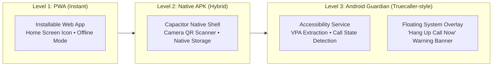

# 📱 UPI Rakshak — Mobile & Smartphone Integration Guide

> **Deploying UPI Rakshak on Smartphones: PWA, Native Android APK, and Background Overlay Guardian**

---

## 1. Why Running on Mobile is Critical

Authorised Push Payment (APP) fraud occurs **on mobile phones**. Victims are targeted while holding their device, frequently during an active phone or video call, while interacting with apps like PhonePe, Google Pay, Paytm, WhatsApp, or Telegram.

To protect citizens effectively, UPI Rakshak supports three progressive mobile integration patterns:



---

## 2. Level 1: Progressive Web App (PWA) Setup

The frontend is already 100% responsive and mobile-friendly. You can install it on any iOS or Android phone without an app store download.

### 2.1 Web App Manifest (`public/manifest.json`)
Create `frontend/public/manifest.json`:
```json
{
  "name": "UPI Rakshak — Sovereign Defense",
  "short_name": "UPI Rakshak",
  "start_url": "/",
  "display": "standalone",
  "background_color": "#060d18",
  "theme_color": "#0f2b5b",
  "orientation": "portrait-primary",
  "icons": [
    {
      "src": "/icon-192.png",
      "sizes": "192x192",
      "type": "image/png"
    },
    {
      "src": "/icon-512.png",
      "sizes": "512x512",
      "type": "image/png"
    }
  ]
}
```

### 2.2 How to Install on Mobile:
1. Open the hosted URL or local IP (e.g. `http://192.168.1.5:5173`) in Chrome (Android) or Safari (iOS).
2. Tap the browser menu `⋮` (Chrome) or Share `⎋` (Safari).
3. Select **"Install App"** or **"Add to Home Screen"**.
4. The app launches full-screen with no URL bars and runs offline using the local fallback engine in `api.js`.

---

## 3. Level 2: Native Android APK via Capacitor

To compile UPI Rakshak into a standalone `.apk` installable file:

### 3.1 Initialize Capacitor
From `frontend/`:
```bash
# 1. Install Capacitor dependencies
npm install @capacitor/core @capacitor/cli @capacitor/android

# 2. Initialize Capacitor project
npx cap init "UPI Rakshak" "in.upirakshak.app" --web-dir "dist"

# 3. Add Android platform
npx cap add android
```

### 3.2 Build & Synchronize
```bash
# 1. Build optimized React bundle
npm run build

# 2. Copy web assets to Android project
npx cap copy

# 3. Open in Android Studio
npx cap open android
```
From Android Studio, click **Build > Build Bundle(s) / APK(s) > Build APK(s)** to generate `app-debug.apk`.

---

## 4. Level 3: Android Native Guardian Service (Truecaller for UPI)

This is the ultimate automated defense architecture. An Android app running in the background detects when a UPI app opens and checks if a phone call is active.

### 4.1 Android Permissions (`AndroidManifest.xml`)
```xml
<manifest xmlns:android="http://schemas.android.com/apk/res/android"
    package="in.upirakshak.guardian">

    <!-- Detect active phone calls -->
    <uses-permission android:name="android.permission.READ_PHONE_STATE" />
    <uses-permission android:name="android.permission.READ_CALL_LOG" />
    
    <!-- Display warning overlay over PhonePe/GPay -->
    <uses-permission android:name="android.permission.SYSTEM_ALERT_WINDOW" />
    
    <!-- Accessibility permission to inspect on-screen payment details -->
    <uses-permission android:name="android.permission.BIND_ACCESSIBILITY_SERVICE" />
</manifest>
```

### 4.2 Active Call Coercion Listener (Kotlin)
Detects if the user is on a call while opening a payment app:

```kotlin
package in.upirakshak.guardian

import android.content.BroadcastReceiver
import android.content.Context
import android.content.Intent
import android.telephony.TelephonyManager

class CallStateReceiver : BroadcastReceiver() {
    override fun onReceive(context: Context, intent: Intent) {
        val state = intent.getStringExtra(TelephonyManager.EXTRA_STATE)
        
        if (state == TelephonyManager.EXTRA_STATE_OFFHOOK) {
            // User is actively on a phone call!
            GuardianState.isCallActive = true
            
            // If a payment app is in the foreground, trigger floating warning
            if (GuardianState.isPaymentAppForeground) {
                OverlayService.showCallCoercionWarning(context)
            }
        } else if (state == TelephonyManager.EXTRA_STATE_IDLE) {
            GuardianState.isCallActive = false
            OverlayService.dismissWarning(context)
        }
    }
}
```

### 4.3 Floating Safety Overlay (Window Manager)
Injects an unyielding red warning over the screen:

```kotlin
package in.upirakshak.guardian

import android.content.Context
import android.graphics.PixelFormat
import android.view.Gravity
import android.view.LayoutInflater
import android.view.View
import android.view.WindowManager

object OverlayService {
    private var overlayView: View? = null

    fun showCallCoercionWarning(context: Context) {
        val wm = context.getSystemService(Context.WINDOW_SERVICE) as WindowManager
        val inflater = LayoutInflater.from(context)
        
        val params = WindowManager.LayoutParams(
            WindowManager.LayoutParams.MATCH_PARENT,
            WindowManager.LayoutParams.WRAP_CONTENT,
            WindowManager.LayoutParams.TYPE_APPLICATION_OVERLAY,
            WindowManager.LayoutParams.FLAG_NOT_FOCUSABLE or WindowManager.LayoutParams.FLAG_WATCH_OUTSIDE_TOUCH,
            PixelFormat.TRANSLUCENT
        ).apply {
            gravity = Gravity.TOP
            y = 100
        }

        overlayView = inflater.inflate(R.layout.overlay_call_warning, null)
        wm.addView(overlayView, params)
    }

    fun dismissWarning(context: Context) {
        overlayView?.let {
            val wm = context.getSystemService(Context.WINDOW_SERVICE) as WindowManager
            wm.removeView(it)
            overlayView = null
        }
    }
}
```

### 4.4 Overlay XML Layout (`res/layout/overlay_call_warning.xml`)
Renders:
> **⚠️ CRITICAL ADVISORY: YOU ARE ON A LIVE PHONE CALL**  
> Scamsters keep victims on call to induce panic. Legitimate banks and police NEVER ask you to enter your UPI PIN while staying on call.  
> **[DISCONNECT CALL NOW]**

---

## 5. Summary Recommendation

| Stage | Goal | Recommended Approach | Time to Deploy |
|---|---|---|:---:|
| **Immediate Demonstration** | Show judges/users how it runs on their mobile phone right now. | **Path 1: PWA** | 5 mins |
| **Submission / Distribution** | Distribute an installable `.apk` file for testing. | **Path 2: Capacitor** | 15 mins |
| **Production Scale** | Automated, background guardian intercepting PhonePe/GPay. | **Path 3: Kotlin Guardian Service** | Future Phase |
