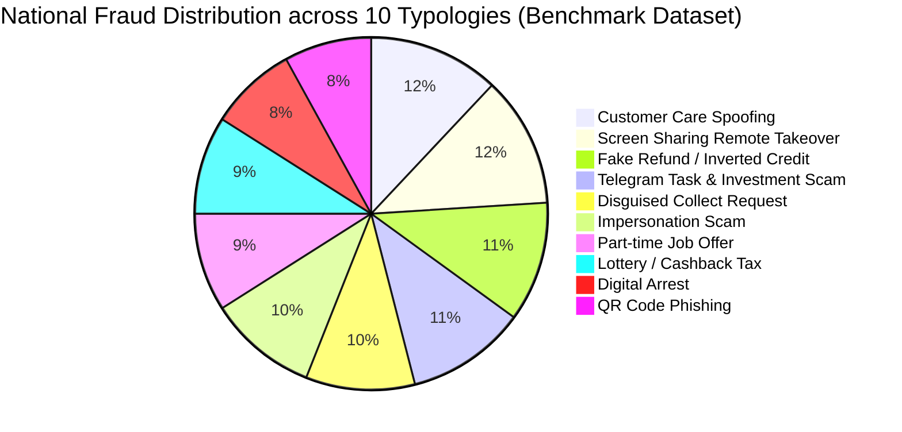
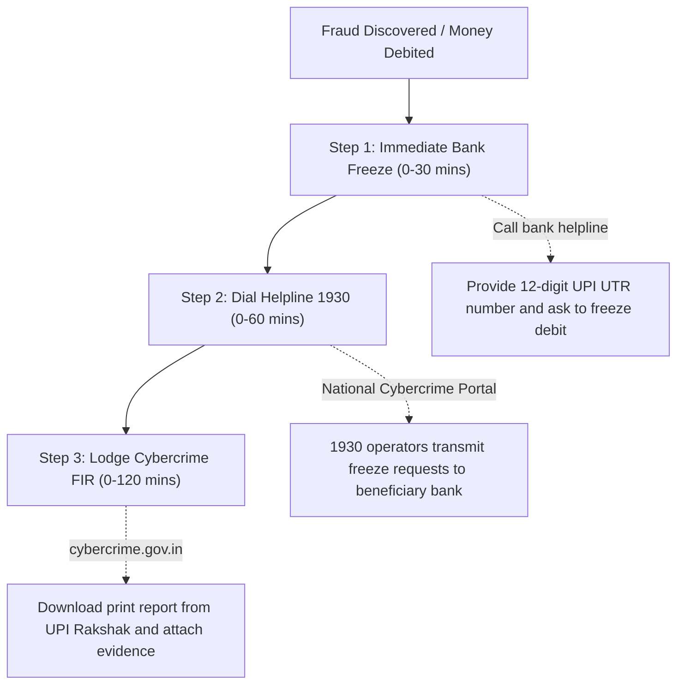

# 🕵️ UPI Rakshak — Threat Typologies & Incident Playbook

> **Deep Analysis of 10 UPI Social Engineering Vectors, Mechanics, and Golden Hour Protocols**

---

## 1. The Threat Matrix

---

## 2. Detailed Typology Breakdown

### Typology 01: Fake Refund & Reversal (Inverted Credit Trap)
- **Modus Operandi**: The attacker calls pretending to be e-commerce support (Amazon, Flipkart, Swiggy) or a bank executive, claiming an accidental overcharge or pending cashback of ₹5,000–₹25,000.
- **Deception Mechanism**: The attacker sends a UPI Collect Request or guides the victim to click a payment link, telling them: *"Sir, please enter your 6-digit PIN to receive this refund into your bank account."*
- **Psychological Vulnerability**: Fundamental misunderstanding of the UPI protocol. Many citizens do not know that entering a UPI PIN **always debits funds** and is **never required to receive money**.
- **UPI Rakshak Interception**:
  - `pin_to_receive = true` triggers a Layer D Hard Stop: **DO NOT ENTER PIN**.
  - Risk score: **94–100 / 100**.

---

### Typology 02: Digital Arrest & Law Enforcement Extortion
- **Modus Operandi**: Criminals call via Skype or WhatsApp video dressed in counterfeit police/CBI uniforms, showing fake arrest warrants and Supreme Court clearance stamps.
- **Deception Mechanism**: They claim the victim's Aadhaar or SIM was found in a seizure involving narcotics (MDMA) or money laundering. The victim is placed under "Digital Arrest" on video call for hours and coerced into transferring their savings to an "RBI Verification Account" or "Supreme Court Escrow".
- **Psychological Vulnerability**: Paralyzing fear of criminal prosecution, social stigma, and respect for legal uniforms.
- **UPI Rakshak Interception**:
  - Detects keywords: `CBI`, `Narcotics`, `ED`, `Arrest`, `Skype`, `Verification Account`.
  - Active call flag adds $+20$ points.
  - Risk score: **98 / 100**. Action: **`STOP_PAYMENT_AND_INVESTIGATE`**.

---

### Typology 03: Active Phone Call Coercion
- **Modus Operandi**: The attacker insists on staying connected on a live cellular or video call while the victim executes payment.
- **Deception Mechanism**: By keeping the voice line open, the fraudster creates cognitive overload, introduces artificial countdowns (*"Do it in 60 seconds or the server will lock"*), and prevents the victim from asking nearby family members or calling their bank.
- **UPI Rakshak Interception**:
  - Live call detector flags call coercion and triggers bilingual voice/text directives: *"धोखेबाज कॉल पर रखकर दबाव बनाते हैं ताकि आप किसी से पूछ न सकें। तुरंत कॉल काटें!"*

---

### Typology 04: Rapid Multi-Payment / Velocity Split Trap
- **Modus Operandi**: Instead of asking for ₹1,00,000 in one transfer, the fraudster instructs the victim to send ₹5,000, then ₹20,000, then ₹25,000, then ₹50,000.
- **Deception Mechanism**:
  1. Bypasses single-transaction bank velocity limits.
  2. Bypasses cooling-off periods for new beneficiaries.
  3. Desensitizes the victim with micro-transfers before draining the full account.
- **UPI Rakshak Interception**:
  - Layer D velocity engine adds $+22$ points when consecutive transfers are detected.
  - If combined with an active call, enforces a mandatory risk floor of **82/100**.

---

### Typology 05: Screen-Sharing Remote Takeover
- **Modus Operandi**: Attacker claims to solve a technical issue (KYC update, failed payment, electricity bill) and tells the victim to install **AnyDesk, TeamViewer QuickSupport, or RustDesk**.
- **Deception Mechanism**: Once installed, the attacker views the victim's screen, watches them type their UPI PIN, or intercepts incoming bank OTPs.
- **UPI Rakshak Interception**:
  - Remote APK keywords trigger an immediate Layer D Hard Stop: *"Uninstall remote sharing software immediately."*

---

### Typology 06: Search Engine Poisoning / Fake Customer Care
- **Modus Operandi**: Scammers purchase Google Search Ads or edit Google Maps listings for courier companies, airlines, or banks with fraudulent phone numbers.
- **Deception Mechanism**: When victims search for customer support regarding a delayed parcel or refund, they dial the scammer directly.
- **UPI Rakshak Interception**:
  - Flags unverified personal VPAs (`name@ybl` or `xyz@okaxis`) masquerading as official commercial corporate desks (`care@hdfcbank`).

---

### Typology 07: Disguised UPI Collect Request Phishing
- **Modus Operandi**: Scammers trigger an unsolicited Collect Request notification on the victim's phone.
- **Deception Mechanism**: The payment note is disguised as: *"Approved Cashback from PhonePe ₹3,000"*. Clicking "Pay" debits ₹3,000 from the victim.
- **UPI Rakshak Interception**:
  - Checks if the collect request was unsolicited (`collect_request_unsolicited = true`). Adds $+15$ risk points.

---

### Typology 08: Marketplace & OLX QR Code Phishing
- **Modus Operandi**: Purported buyer contacts an OLX seller, agrees to buy furniture/appliances without bargaining, and sends a QR code via WhatsApp.
- **Deception Mechanism**: The buyer says: *"Scan this QR code on GPay to receive your ₹10,000 advance deposit."*
- **UPI Rakshak Interception**:
  - Educates user: Scanning a QR code on PhonePe/Google Pay **only sends money**, never receives funds.

---

### Typology 09: Telegram Task & Investment Fraud
- **Modus Operandi**: Messages offering ₹3,000/day for liking YouTube videos or rating hotels on Google Maps.
- **Deception Mechanism**: Victim is added to a Telegram VIP group. Small initial payouts (₹150) build trust, followed by demands for ₹50,000 "crypto investment taxes" to withdraw accumulated dashboard balances.
- **UPI Rakshak Interception**:
  - Flags Telegram group links, guaranteed return promises, and unregistered individual VPAs.

---

### Typology 10: Emergency Hospital / Friend Impersonation
- **Modus Operandi**: Scammer hacks an acquaintance's WhatsApp account or clones their DP, messaging urgently: *"Bro, urgent emergency! My mother is in the ICU, my bank app is stuck. Please UPI ₹25,000 to this doctor's VPA right now."*
- **Deception Mechanism**: Exploits empathy, urgency, and established social bonds.
- **UPI Rakshak Interception**:
  - Urgency and first-time unverified recipient combination elevates risk to High.
  - Recommends: *"Call this person directly on their standard cellular number before sending funds."*

---

## 3. The Golden Hour Emergency Response Protocol

If a transaction was authorized under manipulation, the victim must act within the **first 120 minutes (The Golden Hour)** before mule syndicates liquidate funds at ATMs:

1. **Step 1: Contact Bank Dispute Department (0–30 mins)**:
   - Call your bank's 24x7 emergency helpline immediately.
   - Quote the **12-digit UPI Reference / UTR Number** from your SMS.
   - Request an immediate **fraud chargeback freeze** on the recipient's bank account.
2. **Step 2: Dial National Cybercrime Helpline 1930 (0–60 mins)**:
   - Dial **`1930`** (Ministry of Home Affairs / I4C).
   - Provide your mobile number, bank name, UTR number, and beneficiary VPA.
   - 1930 triggers an automated freeze API across Indian banks to block mule accounts before cash withdrawal.
3. **Step 3: Lodge Official Complaint at `cybercrime.gov.in` (0–120 mins)**:
   - Go to [cybercrime.gov.in](https://cybercrime.gov.in).
   - Click **"Print Report"** on UPI Rakshak to generate an incident dossier with timestamped SHAP telemetry and attach it as primary evidence.
